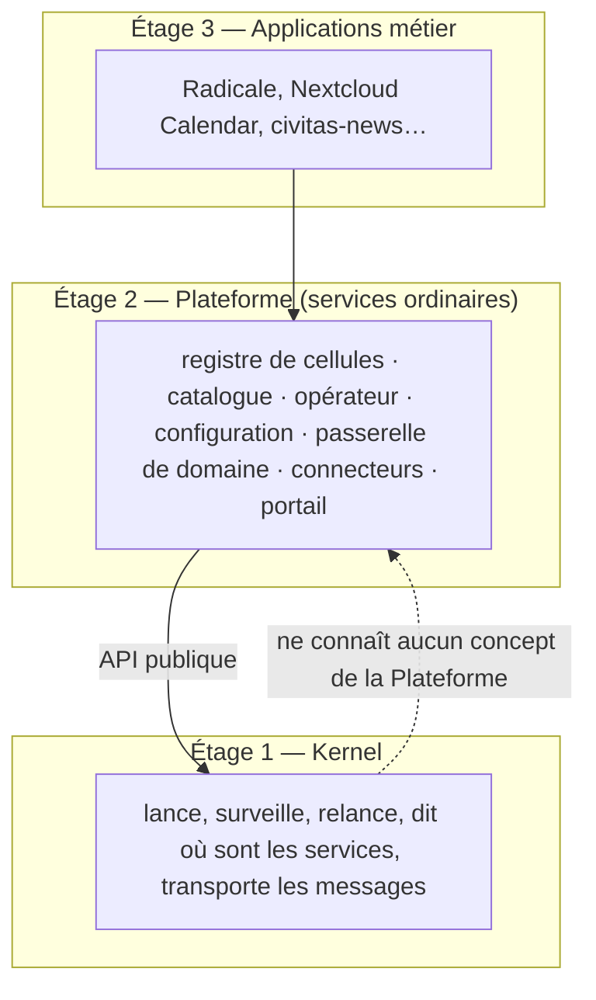
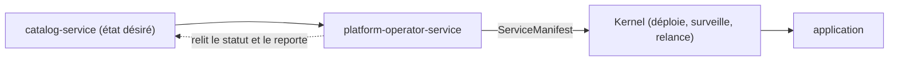
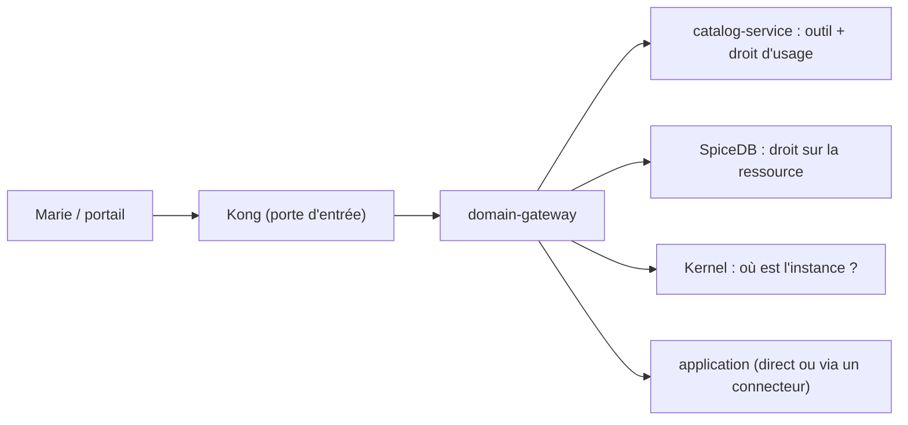

# 03 — Vue d'ensemble de l'architecture

```
┌──────────────────────────────────────────────────────────────────────────────────┐
│                                    CLIENTS                                        │
│        CLI  │  Console Web  │  CI/CD  │  Autres systèmes (via API/gRPC)           │
└───────────────────────────────────┬────────────────────────────────────────────--┘
                                     │  API de contrôle EGEN (REST + gRPC)
┌────────────────────────────────────▼───────────────────────────────────────────---┐
│                              EGEN CORE (hexagone)                                  │
│                                                                                     │
│   ┌────────────────────────────────────────────────────────────────────────────┐  │
│   │  Application Layer (Use Cases / Ports Primaires)                           │  │
│   │  DeployService · RegisterService · ResolveDiscovery · RunWorkflow · ...    │  │
│   └───────────────────────────────┬────────────────────────────────────────────┘  │
│                                    │                                               │
│   ┌────────────────────────────────▼──────────────────────────────────────────┐   │
│   │  Domain Layer (entités, VOs, règles)                                      │   │
│   │  ServiceManifest · DesiredState · ObservedState · DependencyGraph ·       │   │
│   │  LifecycleStateMachine · WorkflowDefinition · ReconciliationEngine        │   │
│   └───────────────────────────────┬────────────────────────────────────────────┘  │
│                                    │  Ports Secondaires (interfaces)                │
│   ┌────────────────────────────────▼──────────────────────────────────────────┐   │
│   │  DeploymentPort │ DiscoveryPort │ MessagingPort │ ConfigPort │             │   │
│   │  SecretsPort    │ ObservabilityPort │ RegistryStorePort │ WorkflowStorePort│   │
│   └──┬───────────────┬───────────────┬──────────────┬─────────────┬───────────┘   │
└──────┼───────────────┼───────────────┼──────────────┼─────────────┼───────────────┘
       │               │               │              │             │
┌──────▼──────┐ ┌──────▼──────┐ ┌──────▼──────┐ ┌─────▼──────┐ ┌────▼─────────┐
│  Nomad      │ │  Consul     │ │  Kafka/NATS │ │  Vault /   │ │  OpenTelemetry│
│  Adapter    │ │  Adapter    │ │  Adapter    │ │  Config    │ │  Collector    │
└──────┬──────┘ └──────┬──────┘ └──────┬──────┘ └─────┬──────┘ └────┬──────────┘
       │               │               │              │             │
┌──────▼──────┐ ┌──────▼──────┐ ┌──────▼──────┐ ┌─────▼──────┐ ┌────▼──────────┐
│    NOMAD    │ │   CONSUL    │ │ KAFKA/NATS  │ │   VAULT    │ │  PROMETHEUS/  │
│  (exécution)│ │ (discovery) │ │ (messaging) │ │ (secrets)  │ │  GRAFANA/     │
│             │ │             │ │             │ │            │ │  JAEGER       │
└──────┬──────┘ └─────────────┘ └─────────────┘ └────────────┘ └───────────────┘
       │
┌──────▼──────────────────────────────────────────────────────────────────────┐
│                     SERVICES AUTONOMES (polyglottes)                        │
│   news-service (Python)  │  billing-service (Go)  │  ged-service (Java)     │
│   notification-service (Rust) │ ... chacun avec son repo, son runtime,      │
│   sa base, son cycle de release                                            │
└───────────────────────────────────────────────────────────────────────────--┘
```

## Ce qui entoure le Kernel : trois étages, deux flux

Le Kernel est l'étage 1. Autour de lui, la Plateforme (étage 2) et les applications métier (étage 3) sont des services ordinaires qu'il lance et surveille ; la frontière est décrite dans [22](22-frontiere-avec-la-plateforme.md).



**Deux moments séparés.** Une application est **installée une fois**, puis **appelée de nombreuses fois**.

*Flux B — installer une application (mise en service).* Exemple : installer Radicale pour le Service RH de l'Université X.



*Flux A — un appel d'utilisateur (moment d'usage).* Exemple : Marie, du Service RH, ouvre son agenda.



Dans le flux A, le Kernel répond seulement à « où est l'instance ? » (découverte). Le détail des deux flux et des termes employés est dans le dépôt `Civitas-EGEN-Business`, `docs/plateforme/03-vue-d-ensemble-des-systemes.md`.

## Ce qui doit rester stable dans le temps

Le **cœur hexagonal** (Application + Domain layers) est la partie du
système qui doit changer le moins souvent. Tout le reste — adapters,
moteurs externes, services métier — doit pouvoir être remplacé sans
toucher au cœur. C'est le test décisif de la réussite architecturale : **la
fréquence de modification de `egen-domain` doit tendre vers zéro** une fois
le Kernel stabilisé (métrique à suivre, voir [19 — Feuille de route](19-feuille-de-route.md)).
